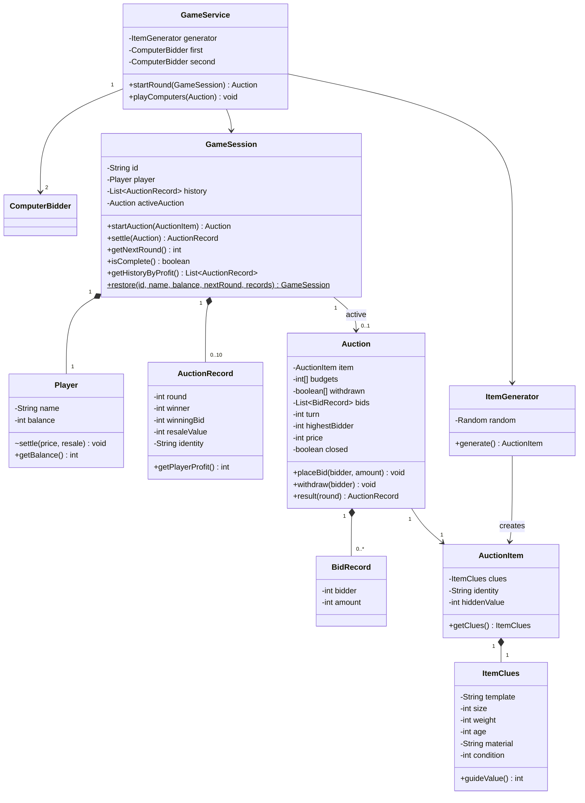
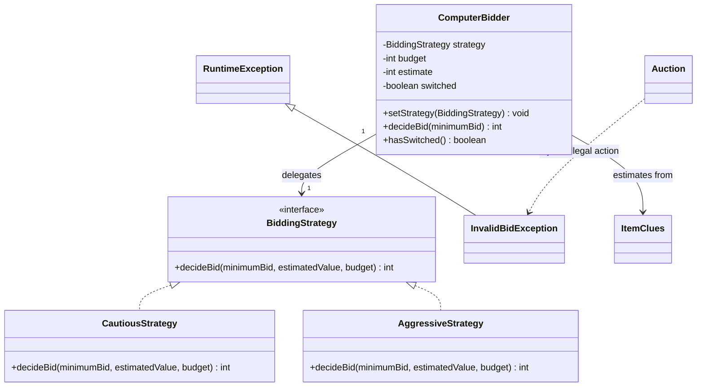
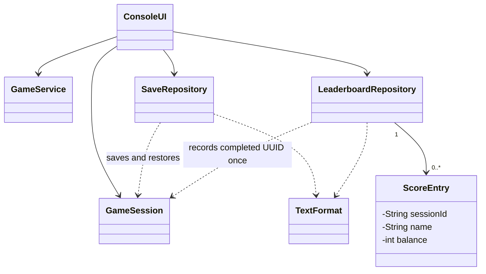

# Implemented Design

The original planning model was simplified to concrete classes and one meaningful policy interface.
No artificial base bidder hierarchy is needed: player finances and computer decisions have different responsibilities.

## Domain and service relationships



## Strategy and exception relationships



The interface returns -1 to withdraw or a proposed minimum bid. Cautious caps at 70%
of estimated value; aggressive caps at 110%. Both check the budget. Estimates use
only `ItemClues`, multiplied by a seeded/random factor from 80% through 120%.
At a minimum bid above 40% of budget, `ComputerBidder.decideBid` calls `setStrategy`
to install a cautious policy once. Computer 2 starts aggressive and therefore changes
policy during sufficiently expensive auctions. The unit test also compares decisions
before and after explicit replacement. Auction validates independently of policy.

## UI and persistence relationships



| Package | Responsibility |
| --- | --- |
| `auction.domain` | Player, clues/item, auction, immutable bid/result data, session, computer bidder |
| `auction.strategy` | One policy interface and two implementations |
| `auction.service` | Round flow, random item generation, computer completion |
| `auction.persistence` | Versioned save and leaderboard files, strict text encoding |
| `auction.ui` | Scanner parsing, System.out menus and errors |
| `auction.exception` | InvalidBidException extends RuntimeException |

## Decisions and invariants

- Java 17, Maven, JUnit 5; no runtime dependencies.
- All fields are private. Results/clues/bid records are immutable; collection getters
  return copies. Only the session calls package-private player settlement.
- Auction validates closed state, participant, withdrawal, turn, amount and affordability
  before mutation. Advancing considers only nonwithdrawn participants other than the leader.
- Without a bid, three withdrawals close an unsold auction. With a leader, closure occurs
  when no other eligible participant remains. Every successful bid increases by at least $10;
  finite budgets bound the number of bids, and each participant can withdraw only once.
- The session owns one active auction. It accepts only that closed object, adjusts funds,
  appends one result, then clears the reference. Repeating settlement fails. Loading restores
  already-settled history directly, with no active auction.
- Appraisal is fixed at construction: `40 + size*20 + weight*4 + age*2 + condition*30 + materialBonus`;
  brass bonus $70, wood $20. All generated attributes increase value monotonically. The exact
  guide is intentionally simple enough for students/players to explain. Identity and appraisal
  accessors are package-private; the UI receives the revealed result only after auction closure.
- New rounds reset each computer's budget to $1,000. There is no opponent cash ledger.
- Sorting uses Comparator on copies for history; scores are returned sorted by final balance.
  Ties retain insertion/chronological order (stable List.sort).

## Text file format

UTF-8, LF or platform line endings, tab-separated fields. Base64 is used for free text,
not encryption. Decoding rejects malformed Base64 or malformed UTF-8.

Save:

```text
MYSTERY-SAVE-1
UUID<TAB>base64(name)<TAB>balance<TAB>nextRound
round<TAB>winner<TAB>winningBid<TAB>resaleValue<TAB>base64(identity)
... up to 10 chronological result lines
```

Winner: -1 unsold, 0 player, 1/2 computer. Unsold bid must be zero; other bids must be
at least $50. Load validates UUID, names, field counts, numeric ranges, round sequence,
next-round count, replay affordability, completion and exact balance. Arithmetic overflow
is rejected. A missing save or corrupt save is an error, never an implicit new game.

Leaderboard:

```text
MYSTERY-SCORES-1
UUID<TAB>base64(name)<TAB>finalBalance
```

Missing leaderboard means an empty board; existing corrupt or duplicate-ID rows are errors.
Recording requires completion and checks UUIDs read from disk, so reload/retry is idempotent.
Writes close a temporary sibling before moving it into place and remove temporary files in
finally. This is a single-process local format; it does not claim crash-safe fsync or locking.

## Limitations

See README for one save slot, RNG continuation, EOF behavior, minimum appraisal,
old-save replay, concurrency and fictional valuation limitations.
