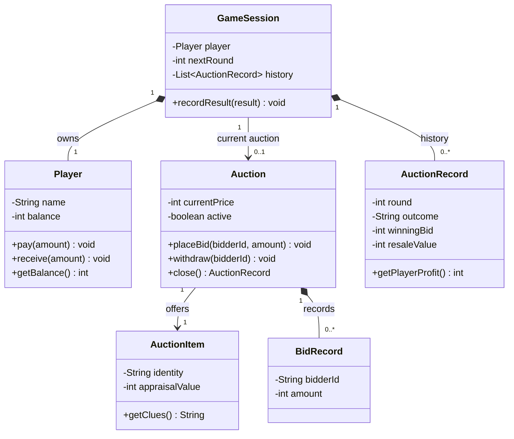
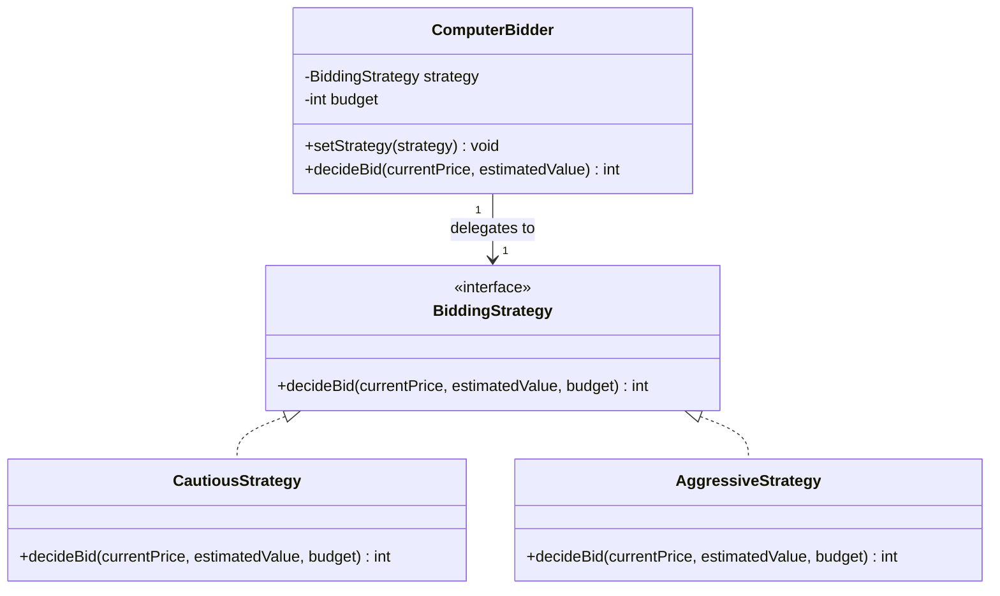

# Proposed Design

This is a planning model, not a diagram of implemented code. Update it as the source code evolves.

## Domain relationships

## Strategy participants

Each Auction has two ComputerBidder objects. The player is identified separately in the round's turn order. A strategy returns -1 to withdraw, otherwise a proposed higher bid. Auction validates proposals independently. Strategies must respect both estimated-value limits and available budgets. Demonstrate runtime replacement through setStrategy, for example switching to a cautious policy when a computer's remaining budget is low.

## Responsibilities and intended packages

| Package | Responsibilities |
| --- | --- |
| auction.domain | Player, Auction, AuctionItem, BidRecord, AuctionRecord, GameSession |
| auction.strategy | BiddingStrategy and its two concrete implementations |
| auction.service | GameService coordinates rounds; ItemGenerator builds consistent items and clues |
| auction.persistence | SaveRepository reads/writes validated game data and scores |
| auction.ui | ConsoleUI handles prompts, parsing and messages |
| auction.exception | InvalidBidException expresses a bidding rule violation |

GameService orchestrates; domain objects do not read console input or open files. Use constructor injection for replaceable strategies and randomness. Keep simple data classes concrete instead of creating an interface for every class.

## Decisions

- Use local simulated auctions to keep the project focused on Java OOP.
- Store money as integer dollars.
- Derive clues and fixed hidden value together at item generation.
- Keep computer estimates separate from hidden appraisal data.
- Check bids before mutating state and settle only once.
- Save between rounds, excluding active-auction state.
- Use generic lists and Comparator-based sorting of copies.
- Choose the exact storage format and JDK during implementation.

## Known limitations

No networking, real money, real appraisal, GUI or mid-auction saves. Balance parameters need playtesting. The diagram, method signatures and package layout are provisional until implementation.
